# MonthGrid
**The watchface I've wanted ever since my old Pebble Steel**
A month calendar watchface for Pebble watches: time on top, a
customizable status line, and a full month grid — inspired by the old ["Calendar Watchface"](https://apps.repebble.com/52c5db770a89c8b9ef000082) by Willian Heaton, But updated and modernized and extended for new 2026 Pebble watches.

**Get it:** [Pebble Appstore](https://apps.repebble.com/865c44435a054e288357979f) · [Rebble Appstore](https://apps.rebble.io/en_US/application/6a94c275784eb40009a8abdd) · or sideload the `.pbw` from the [latest release](https://github.com/OkGoDoIt/pebble-monthgrid/releases/latest)

<p align="center">
  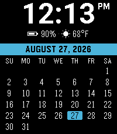
</p>

Tested on my Pebble Time 2 but built to be compatible with all Pebble watches:

| Pebble Time 2 (emery) | Pebble Time (basalt) | Pebble Round 2 (gabbro) | Pebble Time Round (chalk) |
|:---:|:---:|:---:|:---:|
|  | 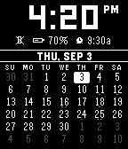 | 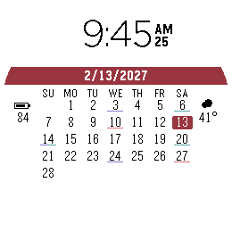 | 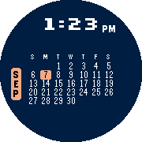 |
| Ice theme, full-date banner, heart rate & weather | Event dots, ruled banner, adjacent months, Digital font | Newsprint theme, custom marker colors, seconds | Midnight theme, Pixel font, round crescent layout |

| Pebble 2 HR (diorite) | Pebble 2 Duo (flint) | Pebble Classic (aplite) |
|:---:|:---:|:---:|
| 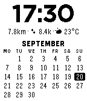 | 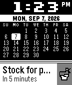 | 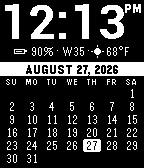 |
| Paper theme, 24-hour, Monday start, metric units | Compressed under a Timeline Peek | Classic look with week number on the original Pebble |

If you test it on any other Pebble watch models, please let me know if you find any issues!

## Features

- **Full month calendar** with today highlighted; optional dimmed previous/next-month days filling the whole grid.
- **Banner options** — the inverted bar shows the month name (default) or full dates:
  month+day, weekday+month+day, with or without the year. Ordering follows your region
  (US: `AUGUST 25`; elsewhere: `25 AUGUST`), names are localized, and long combinations
  automatically shorten (`WEDNESDAY, SEPTEMBER 30` → `WED, SEP 30`) so nothing clips.
- **Big time display** with five selectable font styles — Roboto (default), Digital
  (LECO), Pixel (Silkscreen), Bitham bold / light — in three sizes.
  12-hour mode doesn't show a leading zero. Optional seconds (off by default; the
  face ticks once a minute to save battery unless enabled).
- **Status line** — add items in priority order. As many as fit on the watch are shown. Items with nothing to report are hidden automatically. Choose from:
  - Battery (icon + %)
  - Weather (condition icon + temperature, °F/°C)
  - Steps, Distance walked (mi/km), Heart rate, Active minutes, Calories, Sleep
  - Week number (ISO)
  - Next alarm
  - Disconnected alert
  - With the Pebble app's plugins: next calendar event, phone battery, and your
    own readings 1–5 (see [Pebble app plugins](#pebble-app-plugins-preview))
- **Weather** from the Pebble app's own weather when its plugins are on, otherwise
  via [Open-Meteo](https://open-meteo.com/)
- **Calendar event markers** — up to three iCal/ICS subscriptions (e.g. Google
  Calendar's *Secret address in iCal format*) mark days with events. Two styles: a
  1px underline that splits into per-calendar color sections, or small squares —
  color-coded per calendar on color watches.
- **Timeline Quick View aware** — when the system overlay appears, the face compresses
  (smaller time, then status, banner, header yield) instead of cropping the grid.
- **Round-native layout** on Pebble Time Round and Pebble Round 2: time on the top arc,
  grid across the wide middle of the circle, status metrics stacked in the right crescent. Layout adapts to available space.
- **Color themes** — Classic (white-on-black, default), Paper, Amber
  terminal, Ice, Crimson, Midnight, Terminal green, Sunset, Violet and Newsprint, all
  high-contrast and legible with the backlight off. Custom lets you pick the
  background, text and accent yourself. B&W watches use Classic/Paper.
- **Month banner styles** — filled bar (default), plain text, or ruled with a 1px line
  above and below.
- **Grid borders** — optional thin table lines around the calendar cells, like the
  classic calendar faces. Pick your own border color on color watches.
- Sunday / Monday / Saturday week start
- Vibrate on disconnect

## Settings

Everything is configured from the phone (Settings → MonthGrid). All examples below are on Pebble Time 2.

### Color themes

Ten built-in themes plus **Custom**. The accent colors the month banner and today's
box; text stays high-contrast so every theme is readable with the backlight off.
Black-and-white watches automatically use Classic (or Paper for light themes).

| Classic (default) | Paper | Amber | Ice | Crimson | Midnight |
|:---:|:---:|:---:|:---:|:---:|:---:|
|  |  | 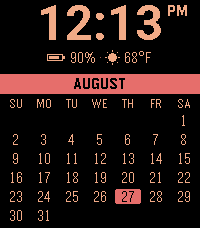 | 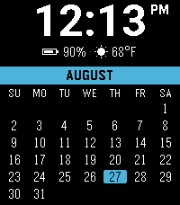 | 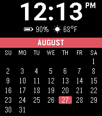 | 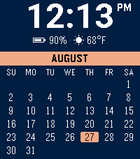 |

| Terminal | Sunset | Violet | Newsprint | Custom |
|:---:|:---:|:---:|:---:|:---:|
| 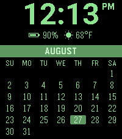 | 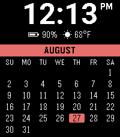 | 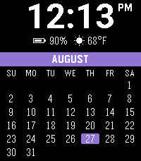 | 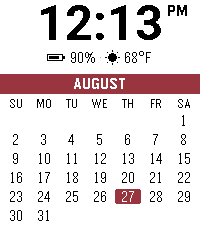 |  |

Picking **Custom** reveals three color pickers (background, text, accent); the
remaining colors are derived automatically for contrast.

### Month banner

**Style** — a solid accent bar (default), plain text, or thin rules above and below. **Content** — from just the month name up to
full dates, ordered for your region and automatically shortened when space is tight.

| Filled bar (default) | Plain text | Ruled |
|:---:|:---:|:---:|
|  | 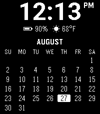 |  |

| Month + day | Weekday, month + day | Month + day, year | Weekday + full date | Numeric |
|:---:|:---:|:---:|:---:|:---:|
| 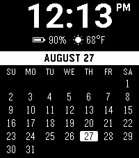 | 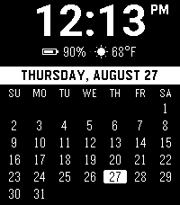 | 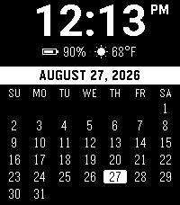 | 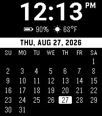 | 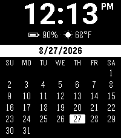 |

### Time display

Five fonts, three sizes, optional seconds, and 12/24-hour (or follow the watch).
12-hour mode doesn't show a leading zero.

| Roboto (default) | Digital | Pixel | Bitham bold | Bitham light |
|:---:|:---:|:---:|:---:|:---:|
|  | 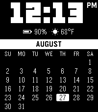 | 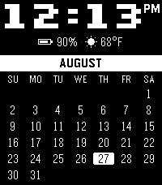 | 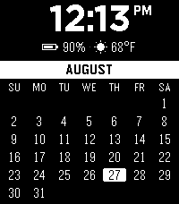 | 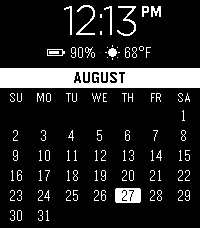 |

| Medium size | Small size | Seconds on | 24-hour (+ °C) |
|:---:|:---:|:---:|:---:|
| 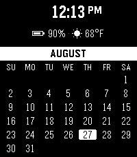 |  | 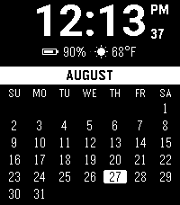 | 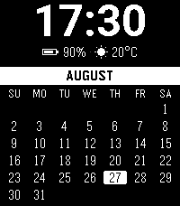 |

### Calendar grid

Start the week on Sunday (default), Monday, or Saturday; two- or one-letter weekday
headers (Pebble Time Round always uses one letter); optionally fill the first and
last weeks with dimmed days from the neighboring months.

| Monday start | Saturday start | One-letter header | Adjacent months |
|:---:|:---:|:---:|:---:|
| 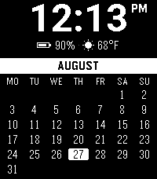 | 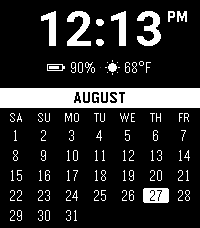 |  |  |

Optional grid borders draw thin table lines around the cells (off by default).
The color is customizable on color watches; black-and-white watches use the text
color.

| Borders on | Custom border color | On a light theme | With adjacent months |
|:---:|:---:|:---:|:---:|
|  | 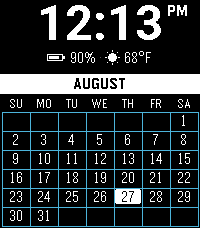 | 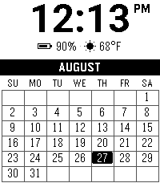 | 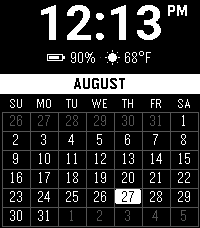 |

### Status line

Add items in priority order. As many as fit
are shown; items with nothing to report (no upcoming alarm, connection fine, etc) hide instead of showing clutter. Choose from battery, weather,
steps, distance (mi/km), heart rate, active minutes, calories, sleep, ISO week
number, next alarm, and a disconnected alert. With the Pebble app's plugins
switched on, three more kinds of item appear: the next calendar event, the
phone's battery, and Readings 1–5 (see below).

| Battery + weather (default) | Battery, weather, steps |
|:---:|:---:|
|  | 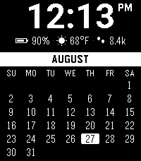 |

### Calendar event markers

Paste up to three iCal/ICS subscription URLs (e.g. Google Calendar's *Secret
address in iCal format*) and days with events get a marker under the date, color
coded per calendar. Two styles: a thin underline that splits into per-calendar
segments, or up to three small squares reflecting how many events the day holds.
The settings page shows a diagnostic message (with a "!" on the watch) if a
calendar fails to refresh.

| Underline (default) | Squares |
|:---:|:---:|
| 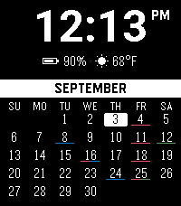 |  |

### And the rest

- **Temperature / distance units** — °F or °C, miles or kilometers. When the
  Pebble app provides your units (plugins on, app 1.16+), the face follows them
  and these two settings disappear from the page.
- **Vibrate on disconnect** — a short pulse when the phone link drops.

## Pebble app plugins (preview)

The official Pebble app can share what it already knows (weather, your
calendar, the phone's state, your favorite readings) through *plugins*, a
preview feature that is off by default. Switch it on in the Pebble app
(1.16: **Settings → Plugins → Plugins / permissions preview**; earlier builds
keep it under the debug options), and MonthGrid uses it:

| What | How it shows | Pebble app |
|---|---|---|
| Weather | The status-line weather comes from your preferred weather provider in the Pebble app (`weather/location`). Open-Meteo is only used when that can't be read. | 1.15+ |
| Units | °F/°C and miles/km follow the Pebble app, and the two unit settings leave the settings page. | 1.16+ |
| **Next calendar event** | A status item: `Standup 23m`, `Lunch 1h05`, then the time of day, then the weekday; `now` once it has begun. The watch does the counting, so it stays right while the phone is away. Long names are shortened so the time always shows. | 1.15+, needs the Calendar permission |
| **Phone battery** | A status item with the phone's battery level. | 1.15+ |
| **Reading 1–5** | Status items showing the readings you picked in the Pebble app (**Settings → Plugins → Complications**), in that order. Change them there and the face follows; the settings page shows what each one currently is. | 1.16+ |
| Forecast | Today's high and low and the next three hours reach the watch. Not shown yet. | 1.16+ (high/low on 1.15) |

The new items only appear on the settings page when the Pebble app can serve
them, and like every status item they hide while they have nothing to show
(no upcoming event, a reading that can't be read, an hour without hearing from
the phone). With plugins off, on older Pebble apps, and in the emulator, the
face works exactly as before.

### Calendar access: the plugins build

Reading your calendar needs the Pebble app's **Calendar** permission, which an
app can only declare in the newer app format (`manifestVersion` 2). The store
build is an older-format app, so the Pebble app treats it as a legacy app: it
may ask before letting it read your calendar, or refuse, depending on the
Pebble app's version and settings.

`tools/pack_plugins_pbw.py` builds a second bundle, `build/monthgrid-plugins.pbw`,
that declares what it uses up front: Calendar, Location, and internet access to
`api.open-meteo.com`. It is the same app (same UUID), so sideloading it replaces
the store version:

- open the `.pbw` on the phone with the Pebble app (for example from Files or
  AirDrop), or
- with Developer Connection on: `pebble install --phone <PHONE_IP> build/monthgrid-plugins.pbw`.

The Pebble app asks for its permissions when it's installed. Your calendar
subscriptions for the event markers are on hosts you chose, so each one asks
for internet access the first time it's fetched. A store update installs the
older-format build over it again.

## Platforms

All seven: `aplite`, `basalt`, `chalk`, `diorite`, `emery` (Pebble Time 2), `flint`
(Pebble 2 Duo), `gabbro` (Pebble Round 2). Health metrics need a health-capable watch;
heart rate needs a watch with an HRM (detected at runtime, hidden otherwise).

I have only run this on the Pebble Time 2 (emery) hardware.  Please let me know if you find any issues with other watches!

## Building

Requires the official [Pebble SDK](https://developer.repebble.com/) (`pebble-tool` ≥ 5,
SDK core ≥ 4.33):

```sh
pebble build
```

Run in the emulator:

```sh
pebble install --emulator basalt
pebble emu-set-timeline-quick-view on    # test the Quick View compression
pebble emu-app-config                    # open the settings page
```

Install on a watch (Dev Connect / Developer Connection in the official app):

```sh
pebble install --cloudpebble             # or: pebble install --phone <PHONE_IP>
```

The sideloadable bundle is `build/monthgrid.pbw`. For the build that declares
its Pebble app permissions (see [Calendar access](#calendar-access-the-plugins-build)):

```sh
python3 tools/pack_plugins_pbw.py          # runs pebble build, writes build/monthgrid-plugins.pbw
```

## Tests

The ICS recurrence engine has a Node test
suite — plain CommonJS, no dependencies:

```sh
node tools/test_ics.js
```

The plugin code runs under a fake Pebble app in Node: it plays weather,
units, calendar, phone, and complications updates at the real `index.js` and
checks the messages sent to the watch, including that unchanged updates send
nothing and that a full update fits the watch's 512-byte inbox:

```sh
node tools/test_plugins.js
```

## Calendar-dot limitations (best-effort ICS)

The phone JS runtime has no timezone database, so `TZID`/floating event times are
treated as phone-local (UTC times are converted properly). The RRULE subset covers
FREQ=DAILY/WEEKLY/MONTHLY/YEARLY with INTERVAL, COUNT, UNTIL, BYDAY (weekly),
BYMONTHDAY (single), and EXDATE; events with ordinal BYDAY (e.g. "2nd Tuesday"),
BYSETPOS, and other exotica mark only their first instance.

## Bundled fonts

The Silkscreen font (used for the "Pixel" time style) is included under its own
license — see `resources/fonts/OFL-Silkscreen.txt`.
